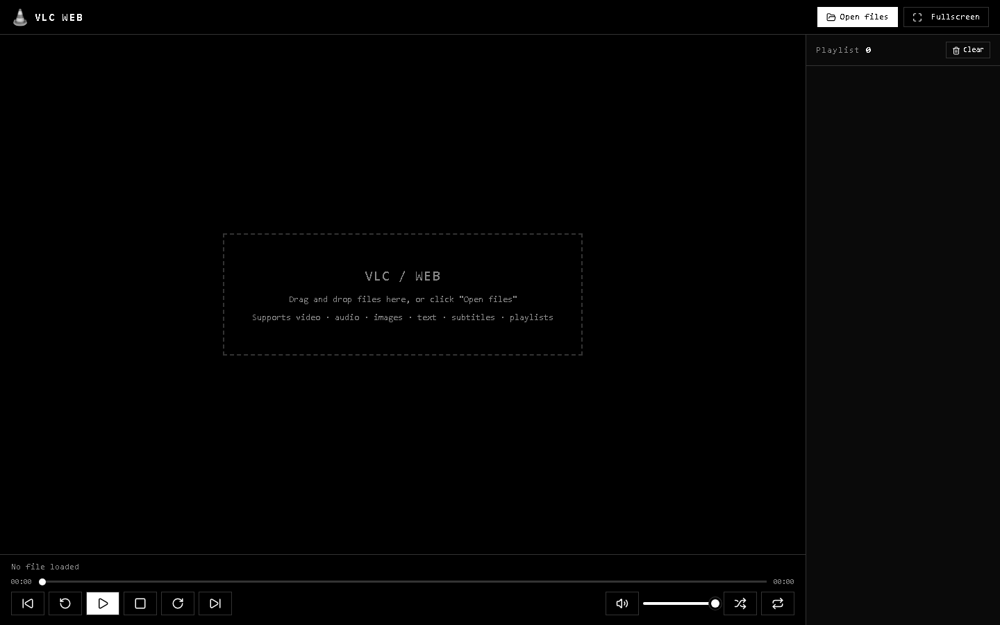

# VLC Web

<p align="center">
  <a href="https://jabar-reda.github.io/vlc-web/">
    
  </a>
</p>

<p align="center">Ein minimalistischer, schwarz-weißer Web-Medienplayer inspiriert von VLC.</p>

<p align="center">
  <a href="../LICENSE"></a>
  <a href="https://jabar-reda.github.io/vlc-web/"></a>
  <a href="../app.js"></a>
</p>

<p align="center">
  <a href="../README.md">English</a> |
  <a href="README.ar.md">العربية</a> |
  <a href="README.fr.md">Français</a> |
  <a href="README.es.md">Español</a> |
  <a href="README.de.md">Deutsch</a> |
  <a href="README.zh.md">中文</a>
</p>

[](https://jabar-reda.github.io/vlc-web/)

---

## Verwendung

### ▶ Online (GitHub Pages)

Öffne **https://jabar-reda.github.io/vlc-web/** in jedem Browser. Das war's — funktioniert über HTTPS von überall.

###  Lokal (file://)

Doppelklick auf `index.html` (oder öffne es in einem beliebigen Browser über `file://`). Keine Abhängigkeiten, kein `npm install`, kein Build-Schritt.

## Funktionen

| Funktion | Beschreibung |
| --- | --- |
|  Video /  Audio | HTML5-Wiedergabe gängiger Webformate (MP4, WebM, MP3, WAV, OGG, …) |
|  Bilder | Anzeige von PNG, JPG, GIF, WebP, SVG und mehr |
|  Text & Untertitel | Anzeige von TXT, MD, SRT, VTT, ASS, CSV, JSON, Logs… |
|  Wiedergabelisten | Öffnen von `.m3u` / `.m3u8` / `.pls`-Dateien (lokal und remote URLs) |
|  Remote-Streams | HTTP(S)-Links per Drag & Drop oder Eingabe laden und direkt streamen |
|  Drag & Drop | Beliebig viele Dateien auf die Seite ziehen |
|  Wiedergabeliste | Einzelne Titel per Klick abspielen, automatischer Weiterlauf, Liste mit einem Klick leeren |
|  Zufällig /  Schleife | Zufällige oder wiederholte Wiedergabe |
| ⏯ Steuerung | Abspielen / Pause, Stopp, Vorheriger / Nächster, ±10s Springen |
|  Lautstärke | Lautstärkeregel mit Stummschalt-Taste |
|  Vollbild | Ein-Klick-Vollbild mit automatisch aktualisierendem Symbol |

## Tastenkürzel

| Taste | Aktion |
| --- | --- |
| `Space` | Abspielen / Pause |
| `` / `` | 10s zurück / vorwärts |
| `` / `` | Lautstärke hoch / runter |
| `N` / `P` | Nächster / Vorheriger |
| `M` | Stummschalten / Ton an |
| `F` | Vollbild umschalten |
| `S` | Stopp |

## Unterstützte Formate

Alles, was der Media-Stack des Browsers unterstützt, wird vom Dateiauswähler und der Dropzone akzeptiert:

- **Video**: MP4 (H.264), WebM (VP8/VP9), MKV, AVI, MOV, OGV, MPEG, M2TS, TS, FLV, WMV, 3GP und mehr.
- **Audio**: MP3, WAV, M4A, AAC, FLAC, OGG, OPUS, WMA, AIFF, MIDI, AMR und mehr.
- **Bilder**: PNG, JPG, GIF, WebP, SVG, BMP, ICO, AVIF, TIFF, JXL.
- **Text / Daten**: TXT, MD, SRT, VTT, ASS, CSV, JSON, XML, Logdateien und jede Erweiterung — unbekannte Dateien werden als Text geöffnet.
- **Wiedergabelisten**: M3U, M3U8, PLS.

> **Hinweis**: Der Browser kann nur wiedergeben, was er nativ unterstützt. Seltene Container wie MKV, AVI oder FLAC werden zur Wiedergabeliste hinzugefügt, können aber möglicherweise ohne Codec-Plugin nicht decodiert werden. Verwende für diese Formate die Desktop-Version von VLC. Ebenso werden Nicht-HTTP-Remote-Links (rtsp, rtmp, mms, ftp) zur Wiedergabeliste hinzugefügt, sind aber im Browser nicht streambar.

## Design

- Rein schwarz-weiße Farbpalette mit dezitem Grau für sekundäre Elemente.
- Monospace-Typografie für einen technischen, terminalartigen Look.
- **Lucide** Linien-Icons (https://lucide.dev) — strichbasierte SVGs, die in `index.html` inline eingebettet sind und `currentColor` verwenden, sodass sie sich automatisch an das Schwarz-auf-Weiß-Thema anpassen, einschließlich invertierter Aktivzustände.

## Architektur

Alles läuft in einem einzigen `app.js`-Classic-`<script>`, weil Browser ES-Module-`import`s auf `file://` blockieren. Eine einzige gebündelte Datei hält den Player ohne Build-Tools, ohne Abhängigkeiten und ohne Server am Laufen. Der UI-Zustand wird über ein festes `setInterval(updateState, 100)` aktualisiert, und Dateien werden über `URL.createObjectURL` geladen, wobei Object URLs beim Entladen wieder freigegeben werden.

## Projektstruktur

```
VLC/
├── index.html   # Seitenauszeichnung + Inline-SVG-Icons
├── style.css    # Gestaltung (monochrome, monospace UI)
├── app.js       # Gesamte Player-Logik (eine Datei, keine Imports)
└── assets/      # Logo, Favicon, Screenshot
```

## Browserunterstützung

- Funktioniert in modernen Chrome, Edge, Firefox und Safari — Desktop und Mobile.
- Läuft vollständig über `file://` — kein Server erforderlich.
- Spielt alles, was der Media-Stack deines Browsers nativ unterstützt (siehe [Unterstützte Formate](#unterstützte-formate)).

## Lizenz

Dieses Projekt steht unter der **MIT-Lizenz** — siehe die Datei [LICENSE](../LICENSE) für Details.
